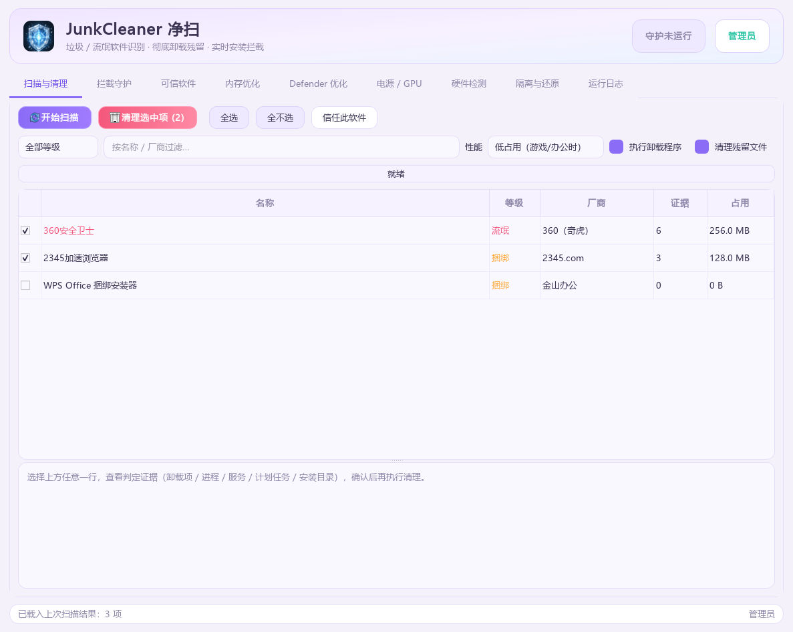
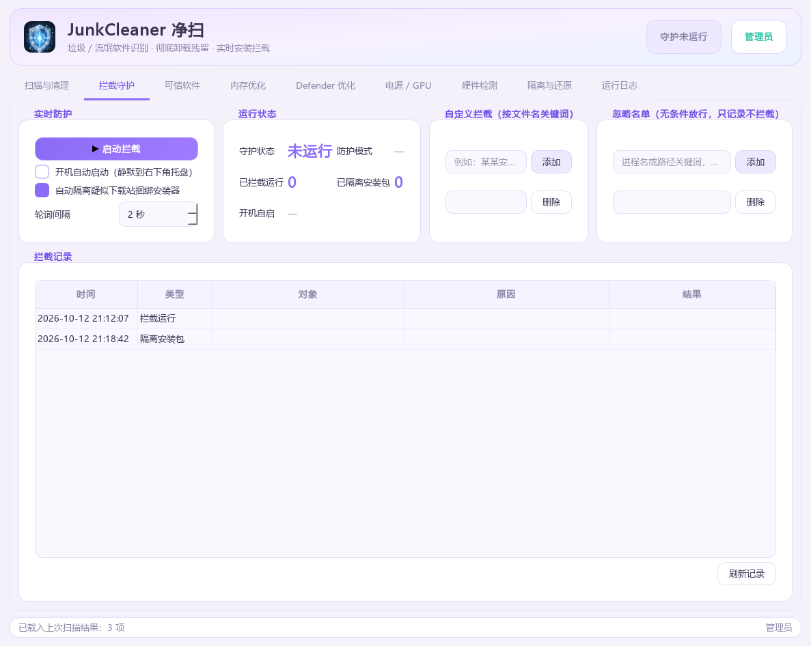
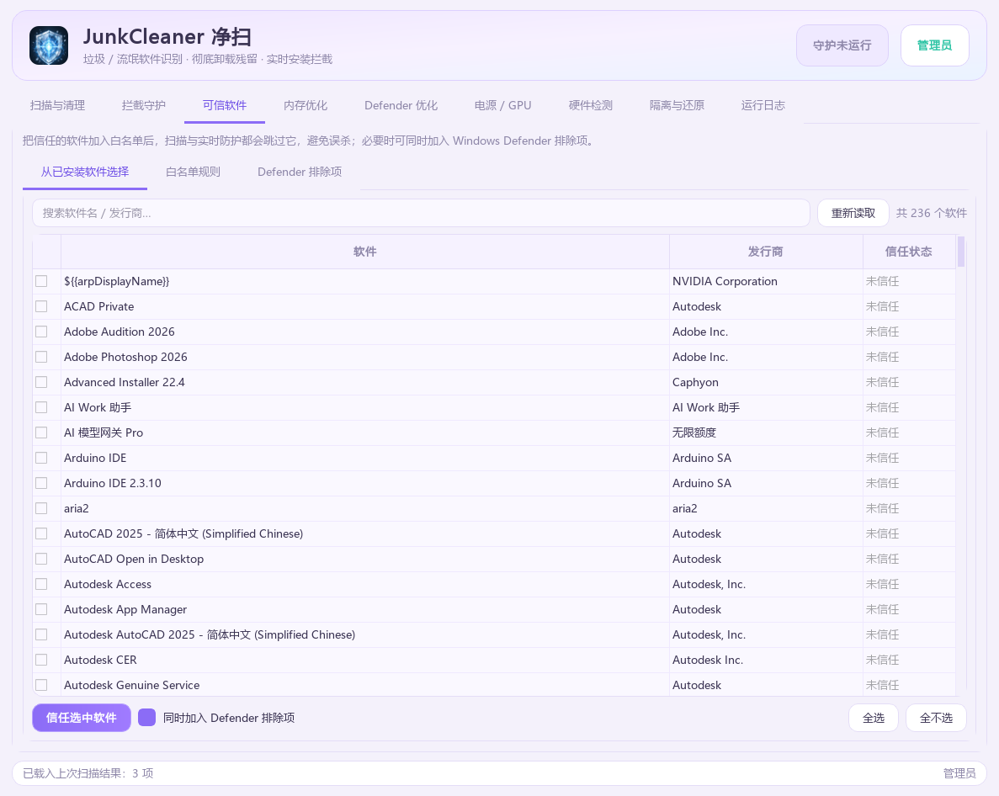
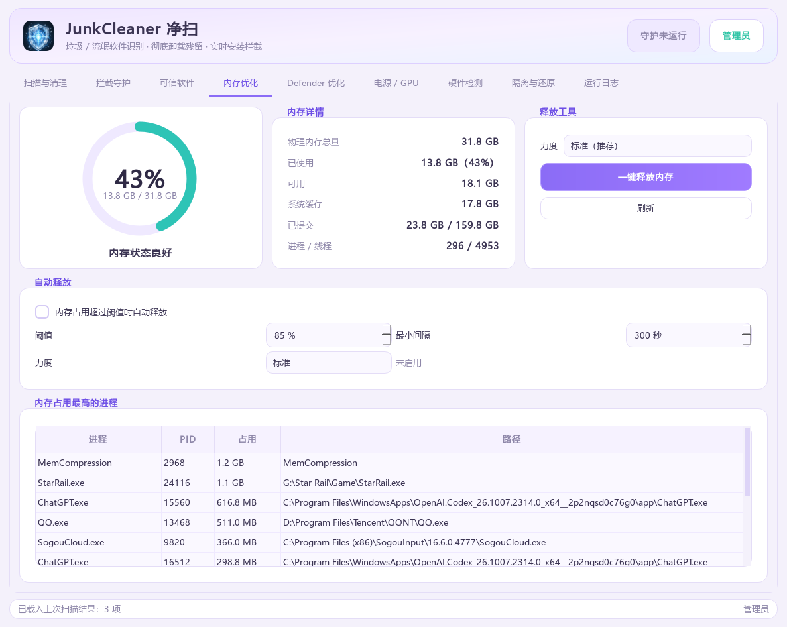
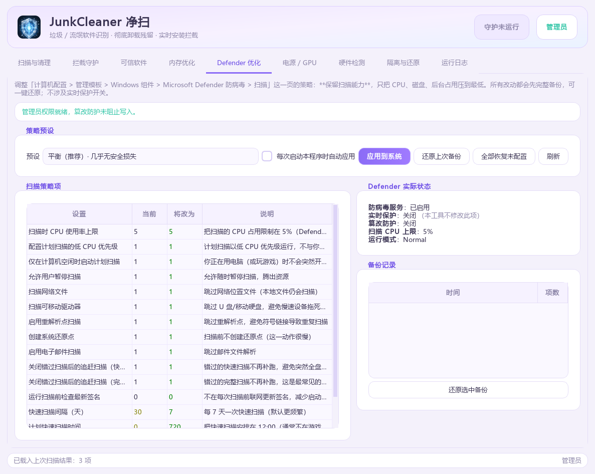
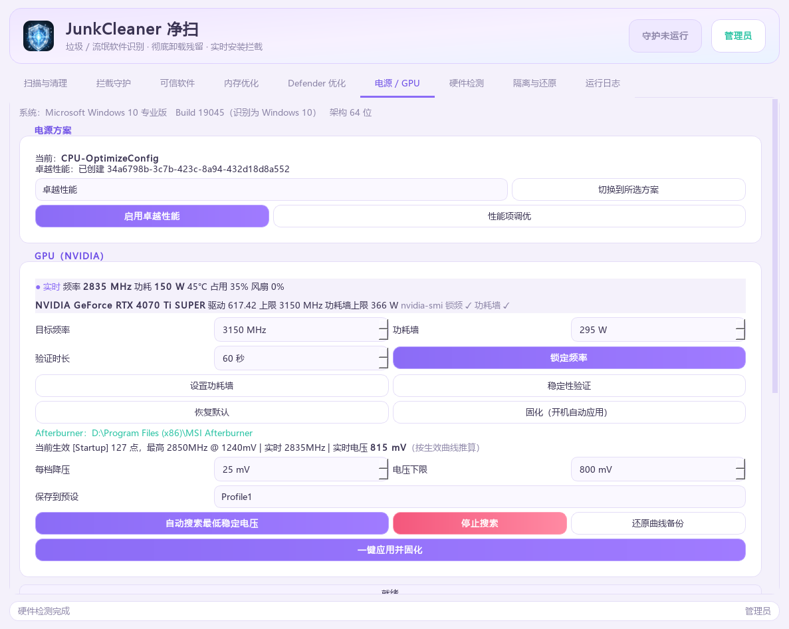
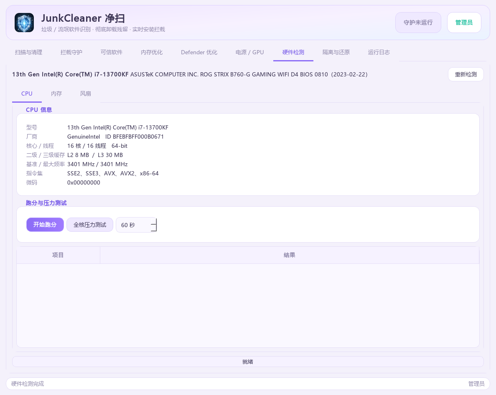
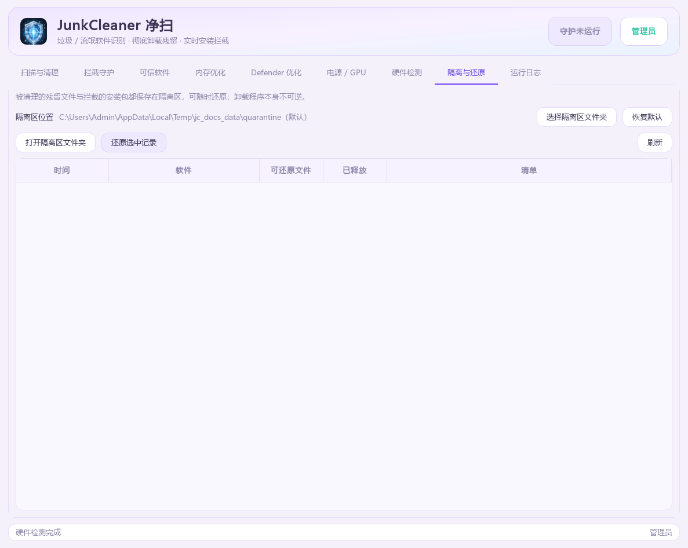
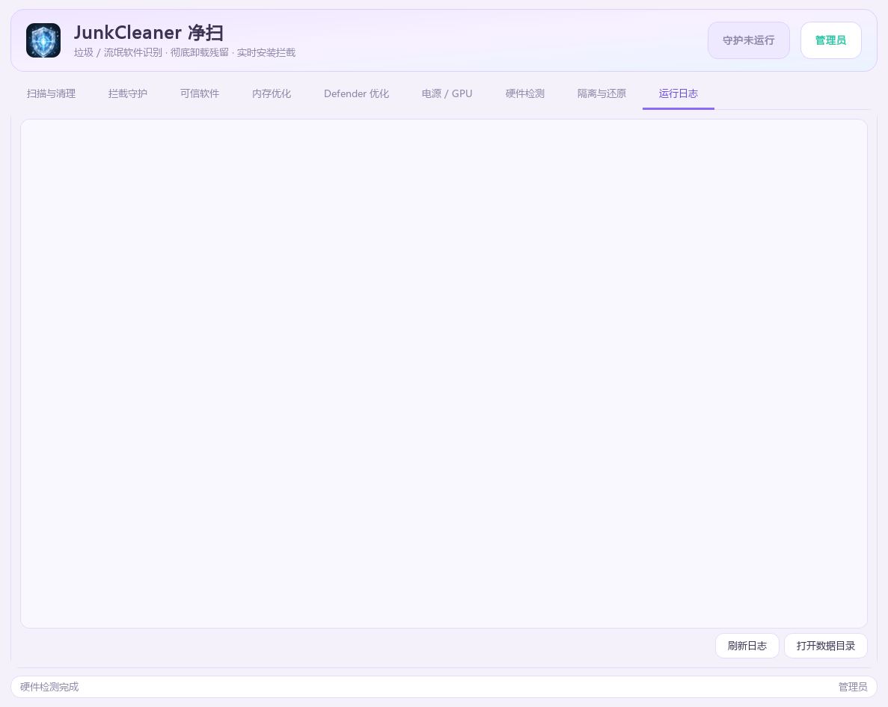

# JunkCleaner 净扫 · 使用说明书

> 面向普通用户与进阶玩家的完整图文明册。从安装启动到每一个功能页，
> 逐项说明它做什么、怎么用、有什么风险。
>
> 截图基于 Windows 10 专业版 + NVIDIA RTX 4070 Ti SUPER 实机运行拍摄。

---

## 目录

1. [这是什么](#1-这是什么)
2. [安装与启动](#2-安装与启动)
3. [主界面总览](#3-主界面总览)
4. [扫描与清理](#4-扫描与清理)
5. [拦截守护（实时防护）](#5-拦截守护实时防护)
6. [开机自动启动](#6-开机自动启动)
7. [可信软件白名单](#7-可信软件白名单)
8. [内存优化](#8-内存优化)
9. [Defender 优化](#9-defender-优化)
10. [电源 / GPU 调优](#10-电源--gpu-调优)
11. [GPU 降压：指定频率找最低稳定电压](#11-gpu-降压指定频率找最低稳定电压)
12. [硬件检测](#12-硬件检测)
13. [隔离与还原](#13-隔离与还原)
14. [运行日志](#14-运行日志)
15. [数据存放位置](#15-数据存放位置)
16. [常见问题](#16-常见问题)
17. [从源码构建](#17-从源码构建)

---

## 1. 这是什么

JunkCleaner 是一款针对 Windows 10 / 11 的工具，做四件事：

| 能力 | 说明 |
|------|------|
| **识别** | 找出垃圾文件、流氓软件、捆绑安装的推广程序 |
| **清理** | 卸载 + 清残留，全部动作先移入**隔离区**，可随时还原 |
| **拦截** | 内核事件驱动的实时防护，新进程一启动就判定，命中立即结束 |
| **调优** | 内存释放、Defender 策略优化、GPU 降压与频率固化 |

它**不联网上传任何数据**，所有判定都在本机完成。

### 适合谁用

- 电脑上被悄悄装了全家桶、浏览器主页被改、弹窗不断的用户
- 想把内存、GPU 功耗压榨出更好表现的用户
- 需要一款不依赖云端、可离线运行的清理工具的用户

---

## 2. 安装与启动

### 方式一：直接用打包好的 EXE（推荐）

1. 获取 `JunkCleaner.exe`（单文件，约 55 MB，内置 NVAPI 调参组件、OpenCL 压测器与显存测试）。
2. 双击运行。程序内置管理员权限清单，**会弹出 UAC 提示，请点「是」**。
3. 拷到任意 Windows 10 / 11 x64 机器即可运行，不需要安装 Python。

> **为什么必须给管理员权限**：结束进程、卸载软件、清空待机内存列表、
> 写计划任务与注册表，都需要管理员权限。拒绝 UAC 后程序仍能打开，
> 但清理与拦截功能会受限。

### 方式二：从源码运行

```powershell
cd I:\CODEX\JunkCleaner
python junkcleaner_entry.py
```

或双击 `launch.pyw`（会自动请求管理员权限）。

### 命令行模式

```powershell
python junkcleaner_entry.py scan                # 只读扫描
python junkcleaner_entry.py scan --json         # 输出 JSON
python junkcleaner_entry.py clean --risk bundle # 清理流氓+捆绑（需确认）
python junkcleaner_entry.py guard               # 后台拦截守护
python junkcleaner_entry.py status              # 查看状态
```

---

## 3. 主界面总览



界面共 **9 个页签**，全部为原生 PySide6 绘制，无需额外运行库：

| 页签 | 作用 |
|------|------|
| 扫描与清理 | 找出问题并处理 |
| 拦截守护 | 实时防护、开机自启 |
| 可信软件 | 白名单，避免误杀 |
| 内存优化 | 检测与释放内存 |
| Defender 优化 | 降低 Defender 扫描的性能损耗 |
| 电源 / GPU | 电源方案、GPU 降压调优 |
| 硬件检测 | 硬件信息、CPU 跑分、内存测试 |
| 隔离与还原 | 查看与还原被清理的文件 |
| 运行日志 | 完整操作与拦截记录 |

右上角两个状态胶囊：

- **守护运行中 / 守护未运行** —— 实时防护的当前状态
- **管理员 / 普通用户** —— 当前是否具备管理员权限

---

## 4. 扫描与清理

### 操作步骤

1. 点左上角 **开始扫描**。
2. 等待进度条走完（低占用档约 37 秒）。
3. 表格列出所有命中的软件，每行显示：名称、等级、厂商、证据数、占用空间。
4. 点任意一行，**下方会展开判定证据**（卸载注册表项 / 进程 / 服务 /
   计划任务 / 开机自启 / 安装目录），确认无误后再清理。
5. 勾选要处理的项目，点 **清理选中项**。

### 等级含义

| 等级 | 含义 | 默认勾选 |
|------|------|----------|
| 流氓 | 强制捆绑、难以卸载、弹窗广告、劫持主页 | 是 |
| 捆绑 | 以捆绑推广、诱导安装为主 | 是 |
| 争议 | 是否属于垃圾存在分歧 | 否 |
| 正常 | 已知正常软件，仅作提示 | 否 |

### 性能档位

扫描页提供三档，默认 **低占用**，玩游戏或办公时几乎无感：

| 档位 | CPU 目标 | 实测整机 CPU | 实测磁盘读 | 扫描耗时 |
|------|---------|-------------|-----------|---------|
| 低占用（默认） | 0.125 核 | 平均 0.68% / P95 2.78% | 0.02 MB/s | ~37s |
| 均衡 | 0.30 核 | 平均 1.86% / P95 5.4% | 0.05 MB/s | ~15s |
| 快速 | 不限 | 平均 4.86% | 0.12 MB/s | ~5.5s |

### 两个开关

- **执行卸载程序** —— 调用软件自带卸载器（不可逆）
- **清理残留文件** —— 把残留文件与目录移入隔离区（可还原）

> 建议第一次只勾「清理残留文件」，确认没问题后再启用卸载程序。

---

## 5. 拦截守护（实时防护）



### 三层叠加的防护

这不是简单轮询，而是三层同时工作：

1. **进程启动追踪** —— 订阅 WMI `Win32_ProcessStartTrace`（内核 ETW 事件），
   新进程一出现立即拿到 PID 与名称并判定，命中特征立即结束进程。
2. **目录变更通知** —— 用 `ReadDirectoryChangesW` 监听下载、桌面、Temp、
   INetCache 等位置，可执行文件一落地就判定，命中则移入隔离区。
3. **兜底轮询** —— 默认 2 秒，仅在事件源不可用时作为保险。

界面上的「防护模式」会显示当前是否为「内核事件驱动」。实测响应在
毫秒到数百毫秒级。

### 新进程的 7 级判定链

| 顺序 | 判定 | 说明 |
|------|------|------|
| 1 | 显式拦截名单 | 用户点名要拦的，优先处理 |
| 2 | 忽略名单 | 命中即无条件放行 |
| 3 | 可信白名单 | 按路径 / SHA-256 指纹 / 发行商 / 名称匹配 |
| 4 | 已知正常软件本体 | WPS、搜狗输入法等放行 |
| 5 | **父子进程判定** | 正常软件拉起的第三方安装 → 拒绝 |
| 6 | 签名特征匹配 | 进程名 / 命令行命中流氓签名 |
| 7 | 启发式兜底 | Temp/下载目录 + 强捆绑命名特征 |

### 捆绑软件是怎么认出来的

捆绑的本质是「A 软件在运行中偷偷拉起 B 安装包」。所以核心是
**父子进程关系 + 子进程特征**双重判定：

```
父进程是已知正常软件（wps.exe / SGTool.exe …）
        且
子进程满足以下任一：
  · 强捆绑特征命名（下载器 / 安装管家 / 游戏盒 / 推广 / 全家桶 / softmgr / tgp）
  · 命中流氓软件签名（如子进程叫 360tray.exe）
  · 通用安装器命名（setup / install / 安装）且位于 Temp/下载/桌面/INetCache
→ 结束该子进程，并记录事件
```

两个条件必须同时成立，所以 **WPS 自己的正常子进程不会被误杀**。

### 操作

- **启动拦截 / 停止拦截** —— 手动开关实时防护
- **自动隔离疑似下载站捆绑安装器** —— 落地即拦的开关
- **轮询间隔** —— 兜底轮询频率

---

## 6. 开机自动启动

在「拦截守护」页勾选 **开机自动启动（静默到右下角托盘）**。

### 工作方式

- 写入当前用户的登录启动项（注册表 `HKCU\...\Run`），**不使用计划任务**
- 开机后**不弹主窗口**，直接静默驻留右下角托盘
- 托盘图标双击即可打开主界面
- 启动时会自动接管拦截守护

### 如何关闭

取消勾选即可。程序会同时清掉早期版本可能留下的计划任务，
不会出现两条自启同时生效。

### 关于权限的说明

登录启动项以**当前用户**身份运行，不注入 SYSTEM 高权限。因此开机后
若发现没有管理员权限，守护会提示而不会强行提权。

> 如果你需要开机就以管理员身份静默运行，那必须使用计划任务并勾选
> 「最高权限」。两者只能二选一：本工具默认选择「静默、无感」。

---

## 7. 可信软件白名单



被误判的软件加进白名单后，扫描会标注「可信」且不勾选，实时防护也会放行。

### 四种加入方式

1. **从已安装软件选择** —— 列出全部已安装软件，勾选后一键信任
2. **白名单规则 → 选择文件** —— 按路径放行单个文件
3. **白名单规则 → 选择压缩包内文件** —— 从 zip / 7z / rar / tar
   中选择包内单个文件，自动计算它的 **SHA-256 指纹**加入白名单
4. **扫描与清理页** 勾选结果后点「信任此软件」

### 按内容指纹放行的意义

这是「选单个文件、解压到别处也不会被误杀」的答案：

- **不整包放行**，只把你选中的那个文件按 SHA-256 指纹加入白名单
- 该文件**解压 / 复制 / 改名到任何目录**后运行，指纹一致即放行
- 压缩包里的**其他**文件仍照常判定，不会被连带放行

匹配优先级：**显式拦截名单 > 可信白名单 > 签名与启发式判定**。

### Windows Defender 排除项

「可信软件 → Defender 排除项」可管理 `Get-MpPreference` 的
`ExclusionPath`。加入排除项的路径不再被系统实时保护扫描，
**会降低系统安全性**，界面对此有明确警告，只对确实信任的软件使用。

---

## 8. 内存优化



### 实时检测

物理内存总量 / 已用 / 可用 / 系统缓存 / 已提交，配环形占用图。

### 一键释放的三档力度

| 档位 | 做法 |
|------|------|
| 温和 | 逐进程 `EmptyWorkingSet` 修剪工作集 |
| 标准（推荐） | 温和 + 刷新已修改页面 + **清空待机列表（缓存页）** |
| 深度 | 标准 + 合并内存列表 + 限制文件系统缓存 |

### 自动释放

内存占用超过阈值（默认 85%）且间隔满足（默认 300 秒）时自动执行。

### 实测效果

> 31.8 GB 内存、占用 47.8% 的环境下，一次标准释放回收 **5.5 GB**，
> 修剪 352 个进程工作集。

清空待机列表需要管理员权限。

---

## 9. Defender 优化



目标是把 Defender「扫描」策略带来的性能损耗压到最低，同时保持防护有效。

所有改动**先备份原策略**（存到 `Defender_backups` 目录），可一键还原。
界面会标注每一项的作用与风险，不会做不可逆的系统改动。

---

## 10. 电源 / GPU 调优



这一页分三块：电源方案、GPU 实时状态、GPU 降压调优。

### 电源方案

- **启用卓越性能** —— 创建并切换到「卓越性能」电源方案（台式机适用）
- **性能项调优** —— 调整处理器性能相关项
- **切换到所选方案** —— 在已有方案之间切换

### GPU 实时状态

页面顶部每 3 秒刷新一次，数据直接来自 **NVAPI**：

```
● 实时（NVAPI）　频率 2835 MHz　电压 960 mV　功耗 176 W　45°C
```

下方一行显示显卡型号、驱动版本、频率上限、功耗墙上限。

> **关于实时电压**：`nvidia-smi` 没有电压接口，Afterburner 在部分
> 显卡 / 驱动组合下也不发布核心电压数据源。本版本改为通过 NVAPI
> 直接读取真实核心电压，并同时显示当前已应用的频率 / 电压与开机固化状态。

### 基础操作

| 按钮 | 作用 |
|------|------|
| 锁定频率 | 用 `nvidia-smi --lock-gpu-clocks` 锁定核心频率 |
| 设置功耗墙 | 设定功率上限（瓦） |
| 稳定性验证 | 锁定目标频率并持续采样温度/功耗/降频原因 |
| 恢复默认 | 复位 nvidia-smi 时钟设置 |
| 固化（开机自动应用） | 保存配置并注册登录重应用，驱动重置或重启后自动恢复 |

> **目标频率填一次就会记住**，不会在刷新或搜索后被重置。

---

## 11. GPU 降压：指定频率找最低稳定电压

这是本工具最有技术含量的功能。目标：**你指定一个频率，程序自动找出
能稳定运行的最低电压，写入显卡并注册开机自动应用，不需要 Afterburner。**

### 原理

程序调用内嵌的 `simple-nvidia-undervolt`（MIT License），通过 NVAPI
的 Pstates20 接口直接读写显卡 V/F 曲线。「锁定频率 + 最低电压」的做法
不是只改一个点，而是把曲线在目标电压以上**拉成水平平台**：

- 锚点设为「目标电压 → 目标频率」
- 所有电压更高的点频率统一为目标频率
- 低电压段保持原样，所以待机仍会自然降频

它与 Afterburner 里 `Ctrl+F` 拉平曲线的做法等效，但直接走 NVAPI，
不需要专有软件常驻。

### 操作步骤

1. 在「电源 / GPU」页设置：
   - **目标频率** —— 例如 `2760 MHz`
   - **每档降压** —— 默认 `25 mV`
   - **电压下限** —— 建议 `900 mV`（低于此不再继续降）
   - **验证时长** —— 建议至少 `300 秒`
2. 点 **自动搜索最低稳定电压**。
3. 等待逐档满载测试。每档都会真实跑 CUDA 满载，观察是否掉频、
   驱动是否重置。
4. 搜索结束后点 **一键应用并固化**，写入显卡并注册开机自动应用。

### 搜索流程

```
读取当前已应用电压（不可读时从 NVAPI 曲线按目标频率取参考值）
  → 把曲线锁成「目标频率 @ 起始电压」并验证起始档
  → 每档 -25mV，直接用 NVAPI 写入并应用
  → PyTorch CUDA 满载压测，同时校验实际频率是否达到目标
  → 稳定 → 记录为新回退点继续降
  → 不稳定 → 立即回退到上一档稳定值并停止
  → 点「一键应用并固化」写入显卡 + 注册开机自动应用
```

### 三个关键坑（本工具已处理）

**坑零：换一台电脑就报「CUDA 不可用 / torch 不可用」**

v1.0.4 及更早版本的压测依赖「目标电脑自己装有 CUDA 版 PyTorch 的
Python」，换电脑必然失败，而且会被误报成「起始电压不稳定」。

v1.0.5 起改为**内嵌 OpenCL 压测器**，随程序一起分发，只依赖 NVIDIA
驱动，任何装了正常驱动的电脑都能跑。若压测器缺失或驱动异常，程序会在
改动电压之前就明确报错，不再误导。

**坑一：Afterburner 运行时会覆盖外部写入**

Afterburner 用内存里的旧预设覆盖被外部修改的配置，导致电压写了不生效。
本版本改为直接走 NVAPI，不再经过 Afterburner 的 Profile 文件。

**坑二：NVAPI 调参在驱动重置后会丢失**

驱动发生重置（事件日志 Display 4101）后调参可能丢失。因此
「一键应用并固化」会同步注册登录重应用任务，开机或驱动重置后自动恢复。

**坑三：会不会「测出稳定，但进游戏花屏」？**

会，这正是两个测法的差异造成的，程序对此做了两层防护。

差异一：**故障类型不同**。降压不稳有两种表现——

| 表现 | 是否抛异常 | 旧的判定能否发现 |
|------|-----------|----------------|
| 掉频 | 否（时钟变化） | 能 |
| 驱动重置 / CUDA 报错 | 是 | 能 |
| **算错但仍运行（花屏、静默数据损坏）** | **否** | **不能** |

第三类是花屏的典型形态：时钟正常、温度正常、CUDA 不报任何错误，
但矩阵乘的结果已经出错。旧版本只看掉频和异常，所以会把它误判为稳定。

现在每一轮满载都会**校验计算结果**：检查输出是否出现非有限值、
峰值是否异常，命中即判为不稳定。

差异二：**负载性质不同**。压测是**稳态负载**，电流平稳；游戏是
**瞬态负载**，电流突变会让实际供电压降（vdroop）比稳态低一截。
同一个电压，稳态下够用，游戏里就跌破稳定线。

为此程序提供 **「瞬态负载模式」**（默认开启）：在满载与轻载之间反复
跳变（约 120ms 高 / 60ms 低），主动制造电流突变，比恒定满载更接近
游戏工况。关闭它则退化为传统恒定满载压测。

搜索采用阶梯法：从已知稳定电压起每档 -25mV，一旦某档失败就回退到
上一档稳定值并停止。最终停在的稳定档天然带一档 25mV 安全间距。

> 另外建议把单档验证时长设为 **300 秒以上**（默认已是 300 秒）。
> 60 秒太短，容易把临界不稳定的电压误判为稳定。
>
> 即便如此，自动测试也无法完全替代真实场景：**固化后请用你常玩的
> 游戏实测一段时间**，确认无花屏、无闪退再长期使用。

### 安全设计

- 每档失败**立即回退**到上一个经过验证的稳定配置
- 驱动无响应时会等待恢复再继续
- 支持随时「停止搜索」，停下时固定在最后一档稳定值
- 一键「恢复原厂」清空调参并移除登录重应用任务
- 满载负载不可用时**不会给出假结论**，会直接中止并说明原因
- 每轮**校验计算结果**，能发现「时钟正常但算错」这类不抛异常的失败
- 每档 25mV 本身就是安全间距：搜索停在的稳定档时，下一档已经实测失败

### 实测记录（RTX 4070 Ti SUPER）

```
目标 2850 MHz，原厂 1100 mV
 1050 mV  满载 99%，0 掉频             ✓ 稳定
 1025 mV  满载 99%，0 掉频             ✓ 稳定
  ...
  955 mV  满载 99%，0 掉频，45°C，176W   ✓ 稳定
  930 mV  CUDA 负载启动失败               ✗ 回退 955 mV
```

> 满载实测 960mV / 2850MHz / 45°C，功耗从 208W 降到 176W。
> 驱动重置后登录重应用任务会自动恢复该配置。

### 风险提示

电压不足时 NVIDIA 驱动会**重置显卡驱动**（黑屏一下，事件日志出现 Display 41），
系统本身不受影响。但降压本质是超频实验，请务必：

- 保证散热良好
- 单档验证时间不要太短（建议 300 秒以上）
- 每次改动后先跑一轮游戏验证

---

## 12. 硬件检测



只读检测，不改动系统。包含：

- **CPU 信息** —— 型号、核心/线程、缓存、指令集、微码版本
- **CPU 跑分** —— 自研单核 / 多核基准
- **CPU 压力测试** —— 全核负载 + 温度/降频监控
- **内存信息** —— 容量/频率来自 SMBIOS
- **内存测试** —— Windows 级图案测试（分配内存、写入图案、读回校验）
- **风扇检测** —— CPU/主板风扇可读性、GPU 风扇控制能力
- **NVAPI 调参状态** —— 检测内嵌组件是否可用并显示当前电压 / 固化状态

### 显存测试（内嵌 memtest_vulkan）

显存不稳的典型表现是**游戏花屏、贴图异常**，这类错误普通满载压测测不到。
「硬件检测 → 显存」页提供了显存稳定性测试：

- 内嵌开源工具 **memtest_vulkan**（GpuZelenograd，zlib 许可，584 KB）
- 反复写入并**逐字节校验**显存内容，发现位错误立即报出
- 建议至少跑 **6 分钟**；测试期间不要运行游戏或 3D 程序
- 可随时停止，但未跑完时结论不完整

> 该工具测的是**显存**稳定性。如果你花屏是核心降压引起的，还要结合
> 「电源 / GPU」页的瞬态负载降压搜索一起排查。

### 为什么不用 CPU-Z / MemTest86

两者都是专有软件，许可不允许随第三方程序再分发。而且它们的功能
本来就基于公开接口（CPUID、SMBIOS、SPD），所以本工具用公开接口自研实现。

> 内存测试有个原理限制：**Windows 运行时无法测试它自己正在使用的内存**。
> 要全面测试仍需从 U 盘启动 MemTest86+。

---

## 13. 隔离与还原



被清理的残留文件、被拦截的安装包都保存在这里，**可随时还原**。

### 自定义隔离区位置

默认隔离区在 `C:\ProgramData\JunkCleaner\quarantine`。如果你不想让它落在 C 盘：

1. 在「隔离与还原」页点 **选择隔离区文件夹**
2. 选择任意磁盘上的目录（程序会在其下创建 `JunkCleanerQuarantine` 子目录）
3. 程序会校验该位置可写后再保存

点 **恢复默认** 可以随时切回默认位置。

> 如果自定义目录后来不可用（例如移动硬盘拔除），程序会记录一条警告并
> 自动回退到默认目录，不会让清理或拦截直接失败。

### 还原

在列表中选择一条记录，点 **还原选中记录**，隔离的文件会还原回原位置。

---

## 14. 运行日志



完整的操作与拦截记录，按天保存。可用于排查问题，也可作为判定依据。

日志文件位置：`%ProgramData%\JunkCleaner\logs\YYYYMMDD.log`

---

## 15. 数据存放位置

所有数据默认放在 `%ProgramData%\JunkCleaner\`：

| 路径 | 内容 |
|------|------|
| `config.json` | 配置（含自定义隔离区路径） |
| `status.json` | 守护运行状态 |
| `last_scan.json` | 上次扫描结果 |
| `events.jsonl` | 拦截事件 |
| `trust.json` | 可信白名单 |
| `logs\` | 运行日志 |
| `quarantine\` | 隔离区（可自定义到其它盘） |
| `tools\` | 内嵌 NVAPI 调参工具释放目录 |
| `defender_backups\` | Defender 策略备份 |

无写权限时会自动回退到 `%LOCALAPPDATA%\JunkCleaner`。

---

## 16. 常见问题

**Q：必须联网吗？**

不需要。所有判定、清理、调优都在本机完成。唯一用到网络的地方是
本版本不需要 Afterburner；调参组件随程序内嵌。

**Q：清理会不会误删重要文件？**

不会直接删除。所有清理动作都是**移入隔离区**，可随时还原。
只有你明确勾选「执行卸载程序」时才会调用软件自带卸载器。

**Q：开机自启为什么托盘里没有图标？**

检查右下角托盘折叠区（点小三角展开）。Windows 会把新图标默认收进折叠区。

**Q：GPU 降压搜索一直失败 / 频率上不去？**

三种常见原因：

1. 调参组件未释放或被杀软拦截 —— 查看运行日志中的 NVAPI 记录
2. 当前电压确实降得太低 —— 调高「电压下限」重试
3. 驱动发生重置后未自动恢复 —— 重新执行「一键应用并固化」

如果报「无法进行满载验证」，说明系统 Python 里缺 CUDA 版 PyTorch，
装一个即可（打包版会调用系统 Python 跑 CUDA 负载）。

**Q：实时电压显示不可读？**

`nvidia-smi` 没有电压接口，Afterburner 在部分显卡 / 驱动组合下也不发布
核心电压数据源。本版本改为通过 NVAPI 直接读取真实电压，若仍不可读，
通常是驱动版本或调参组件未就绪，可查看运行日志。

**Q：为什么不用计划任务做开机自启？**

按需求改成了登录启动项 + 静默托盘，更无感、不依赖 SYSTEM 账户、
也不需要任务计划服务。代价是不能自动获得最高权限，取舍见第 6 节。

**Q：CPU 频率显示的是基础频率，不是当前频率？**

已在 v1.0.3 修复。「CPU」页现在显示三档：

- **当前** —— 真实运行频率（含睿频），每 1.5 秒自动刷新
- **基准** —— 标称基础频率
- **最大** —— 型号名里标注的睿频上限

原理：以前读的是注册表 `~MHz` 和 `Win32_Processor.MaxClockSpeed`，
这两项返回的其实是**基准频率**。现在改用 Windows 性能计数器
`% Processor Performance` 换算（实测本机 5263 MHz，而基准只有 3401 MHz）。

**Q：CPU 跑分 / 内存测试点了没反应或直接崩溃？**

已在 v1.0.3 修复，两个都是打包环境特有的问题：

- **CPU 跑分**：多核测试原先用 `multiprocessing.Pool`，打包成单文件 EXE 后
  子进程需要重新引导整个程序，会因句柄/权限失败（`WinError 5`）。
  现改为用 `subprocess` 拉起自身 + 隐藏参数，行为完全可控。
- **内存测试**：原先依赖 `numpy`，而 `numpy` 被 spec 的 `excludes` 排除了，
  导致直接 `ModuleNotFoundError`；且旧写法会为每个 4 字节创建 Python 对象，
  大内存下会把进程撑爆。现改为 `bytearray` 分块处理，零第三方依赖。

---

## 17. 从源码构建

### 创建构建环境并打包

```powershell
python build_exe.py            # 标准版（内嵌 NVAPI 调参组件与显存测试）
python build_exe.py --bundle-ab  # 旧版兼容参数；当前版本不再需要 Afterburner
```

`build_exe.py` 会自动创建固定版本的构建环境 `.buildvenv`
（**PySide6 6.8.3 + PyInstaller 6.11.1**）。

> **为什么锁版本**：实测 PySide6 6.11.x 与 PyInstaller 6.x 组合打包后
> 运行时报 `ImportError: DLL load failed while importing QtCore`。
> 换成 6.8.3 后稳定。

### 关于第三方组件

GPU 调参使用 `simple-nvidia-undervolt`（MIT License），显存测试使用
`memtest_vulkan`（zlib License），两者都允许随程序分发，许可证与哈希
保存在 `junkcleaner/assets/`。

### 生成说明书截图

```powershell
python tools\make_docs_shots.py
```

### 运行测试

```powershell
python tests\test_gui_smoke.py     # 界面冒烟
python tools\selftest.py           # 自检
```

---

## 附：项目结构

```
JunkCleaner/
├── junkcleaner/            # 主程序包
│   ├── gui.py              # 主窗口与各页签
│   ├── scanner.py          # 扫描引擎
│   ├── signatures.py       # 流氓软件特征库
│   ├── guard.py            # 实时防护、开机自启
│   ├── cleaner.py          # 卸载与清理
│   ├── memory.py           # 内存检测与释放
│   ├── nvbackend.py        # NVAPI 后端封装
│   ├── nvundervolt.py      # NVAPI 降压搜索
│   ├── gpu.py              # nvidia-smi 封装
│   ├── gpu_live.py         # 实时监控读取
│   └── assets/             # 图标等资源
├── tests/                  # 测试用例
├── tools/                  # 诊断与辅助脚本
├── docs/                   # 文档与说明书
│   ├── 使用说明书.md       # 本文件
│   └── images/             # 界面截图
├── build_exe.py            # 一键打包
└── junkcleaner_entry.py    # 程序入口
```
